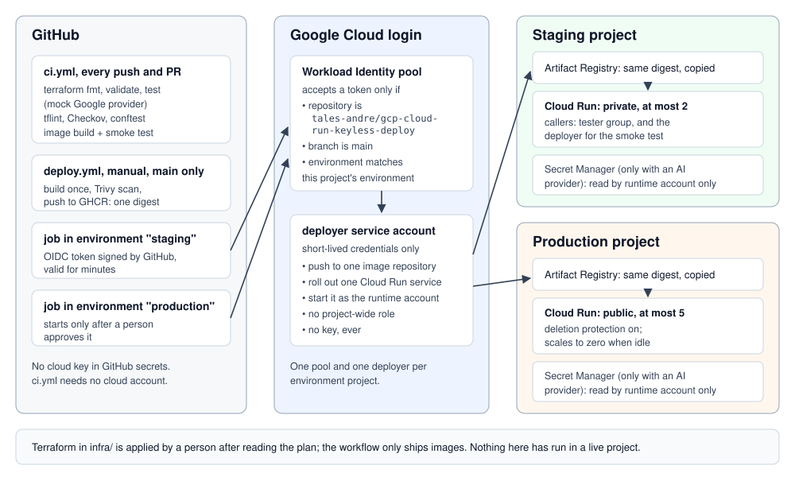

# PDF chatbot packaged for Google Cloud Run, set up for keyless deploys

[](https://github.com/tales-andre/gcp-cloud-run-keyless-deploy/actions/workflows/ci.yml)

**The problem:** a small company has a document
chatbot that works on someone's laptop and wants it running in its own Google
Cloud account: a staging copy for testers, a production copy for customers,
deploys from GitHub, and no service account key sitting in GitHub secrets.

This repository does that for Acme Supply Co., a fictional company, with the
open-source [PDF chatbot](https://github.com/tales-andre/pdf-rag-citations)
from the same author. It contains the Terraform for Cloud Run, the GitHub
Actions that deploy through Workload Identity Federation, and the checks that
prove it offline. It was never applied to a live Google Cloud project: see
[Limits](#limits).



## What this shows

- **Artifact Registry** for the images: tags cannot be moved, and old images
  are cleaned up while the recent ones (the rollback targets) are always kept.
- **One Cloud Run service per environment**, each in its own project, with a
  **cap on instances** (2 in staging, 5 in production) and scale to zero.
- **A runtime service account per service** with no project-wide role: it can
  read its own secret and nothing else, unless the optional database is on
  (then two Cloud SQL roles, limited to that one instance).
- **The AI provider key in Secret Manager**, passed to the container by
  reference. Terraform creates the empty secret and you add the value with
  `gcloud`, so the key never lands in Terraform state. The default offline
  mode needs no key at all, and it is the only mode the image built here
  runs (see [Limits](#limits)).
- **Workload Identity Federation for GitHub Actions**: a token is accepted
  only from this repository, from `main`, and from a job in the matching
  GitHub environment. Production jobs wait for approval once the
  `production` environment has a required reviewer (step 6 of
  [Using it in your own Google Cloud project](#using-it-in-your-own-google-cloud-project)),
  and `deploy.yml` stops before building anything if that rule is missing.
- **A deployer service account with three narrow grants**: push to one image
  repository, roll out one service, start it as the runtime account. In
  staging only, it may also call the service, for the post-deploy smoke test.
- **Staging is never public.** A variable check stops it, a test proves the
  check works, and a policy check reads the environment files.
- **An optional Cloud SQL module**: private IP only, client certificates
  required, IAM login with no database password, backups with point-in-time
  recovery, deletion protection. Off by default; the chatbot does not need it.
- **`import/`**: `import` blocks for a Cloud Run service, a bucket and a secret
  that were made by hand in the console, with a
  [step-by-step walkthrough](import/WALKTHROUGH.md) to "No changes".
- **[What it costs](docs/COST.md)** and **[how to move your domain](docs/CUTOVER.md)**,
  written for the owner.

## Run it yourself

Nothing here asks for a cloud account. You need Terraform 1.11 or newer to
run the tests (they use `override_during`, added in 1.11; CI uses 1.11.3),
Docker, git, curl and jq, and a bash shell (Git Bash works on Windows).

```bash
scripts/fetch-app.sh     # the chatbot at the commit pinned in app.env, into app-src/
scripts/smoke.sh         # build its own Dockerfile, run it offline, ask two questions
scripts/test-infra.sh    # terraform fmt, validate and test, mock provider
scripts/lint.sh          # tflint, Checkov, conftest, actionlint, zizmor, shellcheck
scripts/check.sh         # all of the above, in order
```

The smoke test asks one question the sample documents answer and one they do
not:

```
Q: How much does white-glove delivery cost?
A: White-glove delivery is available for furniture for $149. [1]
   cited: acme-shipping-faq.pdf page 2

Q: Can I pay with cryptocurrency?
A: I couldn't find this in the documents.

OK: answered with a page citation, refused what the documents do not say
```

`scripts/test-infra.sh` removes any Google credentials from its environment
before it starts, and every test file replaces the Google provider with
`mock_provider`, so `terraform test` cannot reach Google Cloud.

## What CI checks

[`ci.yml`](.github/workflows/ci.yml) runs on every push to `main` and every
pull request, on GitHub's runners, with no cloud credentials. Each job calls
the same script you run locally.

| Job | What it checks | It fails when |
|---|---|---|
| terraform | `terraform fmt`, `validate` (also for `import/`), and `terraform test` with a mocked Google provider, run three times: the module and root tests, then the root module with the real `envs/staging.tfvars` and `envs/production.tfvars` | the login condition stops pinning repository, branch or environment; staging can be made public; the instance cap is missing, 0 or above 20; the key could be read by anyone but the runtime account; the database gets a public IP or a password |
| static | tflint (Terraform and Google rulesets), Checkov, conftest | a `google_service_account_key` or a secret version appears anywhere, an IAM grant names `allUsers` directly, the IAM check on requests is turned off, owner, editor or a key- or token-minting role is granted, or staging is opened in its tfvars |
| workflows | actionlint, zizmor, shellcheck | a workflow or script has an error or an unsafe pattern |
| smoke | builds the chatbot's own Dockerfile at the pinned commit and runs it read-only, as non-root, with no capabilities and no AI provider | the answer loses its page citation or the out-of-scope question is answered |

Two kinds of negative tests:

- `terraform test` runs that must be rejected, for example staging with
  `public = true`, `allUsers` in the member list, or a repository name that
  tries to inject into the login condition.
- [`policy/testdata/unsafe/`](policy/testdata/unsafe) holds a service account
  key, a public invoker, a secret value in Terraform and a public staging
  file. `scripts/lint.sh` fails unless conftest rejects every one of them.

`terraform test` can only check resources that exist in the module, so it
cannot prove that no key is created anywhere. That is the conftest policy's
job ([`policy/terraform.rego`](policy/terraform.rego)).

Three Checkov checks are skipped, each with its reason next to the code:
customer-managed encryption keys for Artifact Registry, the per-statement
`log_duration` database flag, and a GitHub OIDC check that cannot read a
condition built from module inputs (the exact condition is asserted by
`tests/github_wif.tftest.hcl` instead).

[`deploy.yml`](.github/workflows/deploy.yml) is the deploy pipeline. It is
started by hand from `main`, and it first checks that the `production`
environment has a required reviewer. It builds the image once with the shared
build workflow from
[github-actions-safe-deploys](https://github.com/tales-andre/github-actions-safe-deploys)
(pinned to a commit), which stops the image if Trivy finds a fixable critical
or high vulnerability. Then it copies that digest into the staging registry,
deploys it, smoke tests it with an identity token, waits for approval, and
deploys the same digest to production. To roll back, start it again with the
previous digest. It has never run: see [Limits](#limits).

## Using it in your own Google Cloud project

Terraform is applied by you, from your machine, after you read the plan. The
GitHub workflow never runs Terraform; it only ships new images.

1. Create one project per environment and a state bucket in each.
2. Edit `infra/envs/<env>.tfvars` (project ID, tester group, caps) and
   `infra/envs/<env>.gcs.tfbackend` (state bucket).
3. Plan and read it, then apply:

   ```bash
   cd infra
   terraform init -backend-config=envs/staging.gcs.tfbackend
   terraform plan -var-file=envs/staging.tfvars -out=staging.plan
   terraform apply staging.plan
   ```

4. Copy `terraform output github_variables` into the repository variables
   (Settings > Secrets and variables > Actions > Variables). None of them is
   a secret.
5. Repeat steps 3 and 4 for production. The `infra/` folder is still set up
   for the staging state, so switch it with `-reconfigure` (it does not move
   or delete the staging state):

   ```bash
   terraform init -reconfigure -backend-config=envs/production.gcs.tfbackend
   terraform plan -var-file=envs/production.tfvars -out=production.plan
   terraform apply production.plan
   ```

   Use `-reconfigure` with the staging file the same way to go back.
6. Create the GitHub environments `staging` and `production` before the first
   deploy, and add a required reviewer to `production`. GitHub would
   otherwise create them on first use with no protection; `deploy.yml`
   refuses to run while `production` has no required reviewer.
7. Optional: set `github_repository_id` in the tfvars once the repository
   exists, so a repository re-created under the same name cannot log in.
8. Optional, and not covered by `deploy.yml`: an AI provider. The chatbot's
   Dockerfile installs the provider packages only when it is built with
   `--build-arg WITH_LLM=1`, and `deploy.yml` builds the default offline
   image (the shared build workflow takes no build arguments). The offline
   image stops at startup if `llm_provider` is set, so first deploy an image
   you built with `WITH_LLM=1`. Then set `llm_provider` and `llm_model`,
   apply, and add the key yourself:
   `printf '%s' "$KEY" | gcloud secrets versions add <secret from the output> --data-file=-`

## Bringing console-made resources under Terraform

`import/` is a separate root module with its own state, for resources someone
already created by hand: a Cloud Run service, the bucket with the PDFs and the
secret with the key. The [walkthrough](import/WALKTHROUGH.md) goes from a
read-only inventory to `import` blocks, adjusting the code (never the live
resources) until the plan shows `3 to import, 0 to add, 0 to change, 0 to
destroy`, then one apply that only writes state, then "No changes". Fixes such
as a lower instance cap or a dedicated runtime account come after, each in its
own reviewed pull request. The secret's value is never imported.

## What it costs and what makes the bill grow

[docs/COST.md](docs/COST.md) goes through each service: what Google charges
for (from the public pricing pages), what makes that line grow, and which
setting here keeps it in check. There is no total, because it depends on your
traffic; the page shows how to estimate it with Google's calculator.

## Moving your domain

[docs/CUTOVER.md](docs/CUTOVER.md) is the checklist for the owner: the old
setup keeps running, the TTL is lowered ahead of time, the new front door is
tested before DNS changes, and going back is one DNS edit.

## Repository layout

```
infra/                  Terraform for one environment per state
  modules/              artifact-registry, cloud-run-service, github-wif, cloud-sql (optional)
  envs/                 staging and production tfvars and backend settings
  tests/                terraform test files and the mock provider values
import/                 separate root module for console-made resources (validated only)
policy/                 conftest rules, their unit tests, and unsafe examples that must fail
docs/                   COST.md, CUTOVER.md, architecture.svg
scripts/                the checks, used the same way locally and in CI
.github/workflows/      ci.yml (push to main, every PR), deploy.yml (manual, never run)
app.env                 the chatbot repository and the commit it is built from
```

## Limits

- **Never applied to a live Google Cloud project.** `terraform test` runs
  against a mocked provider: it checks the values Terraform would send, not
  what Google would accept. Quotas, organization policies, name clashes and
  IAM delays were not tested.
- **The deploy workflow never ran.** No Google Cloud project or repository
  variables were used. The deployer's permissions follow Google's
  documentation, but a first real deploy may still turn up a missing one.
  Its build step calls the shared workflow in `github-actions-safe-deploys`
  at a fixed commit, so that repository has to be public at that commit.
- **The image `deploy.yml` builds is offline only.** It is the chatbot's
  Dockerfile with its defaults (`WITH_LLM=0`), so it has no AI provider
  packages, and with `llm_provider` set it stops at startup. Building an
  image with `WITH_LLM=1` is not part of this repository. The Terraform side
  of a provider (the empty secret, the reference, who can read it) is tested
  offline only.
- **Approval is a GitHub setting, not code.** The production job waits for a
  person only if the `production` environment has a required reviewer.
  GitHub creates an environment named in a workflow on first use, with no
  protection, and the Google login condition can check the environment's
  name but not its rules. `deploy.yml` reads the rules through GitHub's API
  and stops if the reviewer rule is missing; that check has never run either.
- **Who can call each service.** Staging: the tester group, plus the deployer
  so the post-deploy smoke test can reach the private service. Production is
  public (`public = true` in `envs/production.tfvars`), because the sample
  documents are public help pages; set it to `false` for internal documents.
- **The import was never executed.** `import/` has only been through
  `terraform init -backend=false` and `terraform validate`.
- **The login condition assumes GitHub's default `sub` claim**
  (`repo:<owner>/<name>:environment:<env>`). An organization that customizes
  the OIDC subject has to update the condition.
- **The Cloud SQL module is tested offline only**, and the chatbot does not
  use a database, so the app-side connector code is not included.
- **No custom domain front door.** Production gets Cloud Run's own `run.app`
  address; the load balancer for your domain is a separate, priced step (see
  the cutover checklist).
- **The smoke test runs the chatbot offline.** Answers with an AI provider are
  not tested here; see the
  [chatbot's own limits](https://github.com/tales-andre/pdf-rag-citations#limits).
- No monitoring or alerting is set up, by design.
- Project IDs, the tester group and the state buckets in `infra/envs/` are
  placeholders for the fictional company.

## License

MIT. See [LICENSE](LICENSE).
